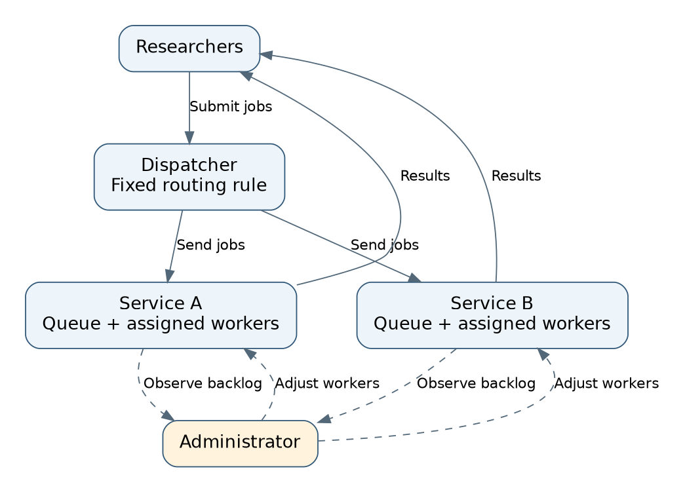
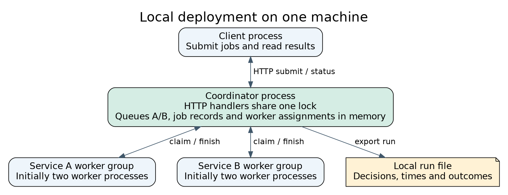

# Coordinated Load and Resource Management Design

Author: Raian Pial

Course: CSC 59866

Selected project : Coordinated Load and Resource Management; based on NSF Award 2542973

Current assignment: 3 — Architecture and component interfaces

Friday commit deadline: November 20, 2026, 11:59 p.m. New York time

Monday presentation: November 23, 2026, 6:30 p.m. New York time

Last updated: November 20, 2026

Document status: Week 3 design and feasibility report

## Progress note

This week I selected the coordinated manager because it can change worker assignments when one service has waiting jobs and the other has a spare worker. I traced two simultaneous requests through the admission decision and defined what the client receives when only one queue slot is open. In a small Python experiment, two request handlers competed for that slot. Across 100 trials, one job entered the queue each time and the other received a capacity rejection. I also corrected the workflow image link and added a research computing example to explain why users care about waiting. My next step is to connect admission to a worker and retrieve the first completed result.

## Contents

* 1 Problem research and scope  
* 2 Requirements and system specification  
* 3 Alternatives and selected solution  
* 4 Architectural design  
* 5 Component design and interfaces  
* 6 Data structure design  
* 7 Algorithm design and execution  
* 8 Failures and security  
* 9 Implementation and feasibility  
* 10 Testing and verification  
* 11 Operation maintenance and future work  
* 12 Revision history and references

## 1 Problem research and scope

### **Problem and affected people**

I am investigating how to decide how much work a service can accept, assign workers to that work, and use those assignments when routing new requests. These decisions can conflict when they use different information. A busy service may continue receiving jobs while another has idle workers. With jobs of different sizes, dividing the number of requests evenly does not necessarily divide the work evenly.

For this prototype, resources mean worker processes, and capacity is represented by worker availability and a bounded waiting queue. The project focuses on application-level coordination. The initial configuration is two equivalent processing services and four workers. The report uses a university research group as its target use case.

The target users are students and researchers in a university research group who submit data-processing jobs to shared computing resources, along with the developer or administrator who maintains that service. For example, they might submit files for a numerical summary and wait for the results before continuing their analysis. Delays affect their work, while the administrator must investigate queues and adjust worker assignments.

| Stakeholder | Task | Need |
| :---- | :---- | :---- |
| Student or researcher | Submit a processing job and use its result | Predictable waiting time and a clear outcome |
| Service administrator | Manage a limited pool of workers | See where work accumulates and use available workers effectively |
| Application developer | Maintain routing and processing behavior | A simple way to coordinate decisions and compare results |

### Current workflow

The starting workflow is as follows: A researcher submits a job to a service. A dispatcher sends the job to one of two processing services, each with its own queue and assigned worker processes. Workers process jobs and return results. The administrator monitors delays and adjusts assignments when needed. In the simple baseline, routing follows a fixed round-robin order and the worker allocation stays fixed.

The difficulty occurs when jobs take different amounts of time or the effective capacity of a service changes. Giving each service the same number of requests does not necessarily give each the same amount of work. Routing can continue sending jobs to a busy service even when another has capacity available. This workflow provides the baseline for comparison.

### **Concrete scenario**

Consider the following scenario: Two researchers submit a mixture of small and large files. Processing Service A is still handling several large files, while Service B has finished most of its smaller files. The round-robin dispatcher continues alternating requests between A and B. A new small job sent to A waits behind expensive work even though B could finish it sooner. The researcher waits longer, and the administrator sees an uneven backlog.

Normally, the submitted job should reach an available worker, finish, and return its result. The proposed investigation asks whether sharing queue and worker information can improve that sequence: the dispatcher could favor a service with available capacity, and a coordinator could move an idle worker to the busier service. If all workers are occupied, the service would need a clear limit on how much additional work it accepts.

![][image1]

Figure 1\. Starting workflow for the research-group use case. Routing and worker allocation are separate decisions. The project investigates sharing information between them. The image shows the system context.

### **Evidence**

The [National Science Foundation (NSF) Award 2542973 abstract](https://www.nsf.gov/awardsearch/showAward?AWD_ID=2542973), titled CAREER: Integrated Load and Resource Management for High-Utilization Datacenters, identifies the separation of resource allocation and load distribution as a source of inefficient resource use and slow responses to changing workloads. It also describes varying request demands, changing bottlenecks, and interference between control mechanisms. This supports the project’s focus on coordinating admission, worker allocation, and routing.

[NGINX's load-balancing documentation](https://nginx.org/en/docs/http/load_balancing.html) describes round-robin routing and least-connected routing. It explains that least-connected routing can help when requests take different amounts of time. This provides an existing approach to study and a reason to test more than equal request distribution.

Princeton Research Computing documents a question its users encounter: a submitted job is still waiting even though processors appear available. The researcher checks the pending reason with the queue command. A job can be held by a resource limit or a reservation, and its start time affects when the researcher can use the output. This gives a documented example of the workflow and delay behind the project. The two-service arithmetic workload and administrator moving workers are local design assumptions. [Princeton queue FAQ](https://researchcomputing.princeton.edu/faq/there-are-plenty-of-proce) · [Job priority](https://researchcomputing.princeton.edu/support/knowledge-base/job-priority)

### **Six-week contribution**

This semester I will investigate one small capability: using shared information about queued work and assigned workers to coordinate where a request is sent and how available workers are assigned. I plan to build a minimal coded prototype with two processing services, a small fixed worker pool, and repeatable short and long processing jobs. The initial working path will accept a job, route it, execute it, and return a result while recording its waiting and completion times.

Within that prototype, I will explore a simple admission limit and reassignment of idle workers between the two services. Running jobs will finish before their workers change assignments. I will compare the coordinated behavior with round-robin routing and fixed worker allocation under the same workload and total worker count. Initial evidence will include completed jobs, waiting or response times, and rejected jobs so that rejecting more work cannot be presented as a performance improvement. Section 2 now defines the initial behavior, correctness rules, and proposed test target. The initial operation computes a numerical summary over generated integer lists.

### **Semester II scope**

The larger goal is a working, evaluated application-level manager that combines request admission, worker allocation, and routing across multiple service instances. Semester II will extend the initial path with more varied workloads, a comparison with an adaptive routing baseline, and tests of delayed status reports and changing capacity. A small chain of services can then be used to investigate backpressure: allowing a busy downstream service to signal upstream components to slow incoming work.

The NSF award's three thrusts concern request-level tracking and admission, integration with operating-system scheduling, and coordination across clusters and microservice chains. My project will explore simplified application-level counterparts: request measurements and limits, worker-process allocation, and routing/backpressure across service instances. It will not reproduce the award's operating-system or hardware research. The initial deployment can use separate communicating processes on one machine, with the shared-machine limitation stated in the results.

### Exclusions

- Kernel changes, hardware modifications, and microsecond-level control guarantees.  
    
- Automatic cloud purchasing, datacenter-scale deployment, and production use.  
    
- Moving or interrupting jobs that are already running.  
    
- Real institutional datasets, real user accounts, and deployment into a university's existing infrastructure.  
    
- Energy-consumption and financial-cost evaluation.  
    
- A full microservice chain, comprehensive recovery system, and polished user interface in the first six-week contribution.

## **2\. Requirements and system specification**

### Prototype boundary and terms

The initial prototype will use two processing services, A and B, and four worker processes on one machine. Both services perform the same numerical-summary operation. A worker handles one job at a time. A job is **waiting** after acceptance and before execution, **running** during execution, and **completed** after its result is recorded.

Each service may hold at most eight waiting jobs, in addition to its running jobs. The initial allocation is two workers per service; an experimental coordinated approach may change this to three and one. These settings define the initial prototype configuration. The queue limit bounds accepted work but does not guarantee a response deadline.

Inputs are a unique job identifier and a list of 1–100,000 integers, each between −1,000 and 1,000. The operation returns the count, sum, and arithmetic mean. Small and large lists provide repeatable workloads for comparing processing costs. A test client can submit jobs and retrieve their status and result. A graphical interface is not required.

### **Functional requirements**

The prefix FR means functional requirement. These identifiers will stay unchanged if the wording is refined. The acceptance checks describe how each requirement will be evaluated.

| ID | Required behavior | Concrete acceptance check |
| :---- | :---- | :---- |
| FR-01 | Validate each submission before scheduling it. Reject an empty list, non-integer values, out-of-range values, oversized lists, or a job identifier already used in the current run. Return a clear reason and leave queues unchanged. | Submit J1 with \[2, 4, 6\], then submit a second J1 and J2 with an empty list. The first request proceeds to admission; the others return duplicate-identifier and invalid-input outcomes. Neither rejected request creates a queued job. |
| FR-02 | Accept a valid job only when at least one service has a free waiting slot. Return accepted with the job and service identifiers, or rejected-capacity if both waiting queues are full. Check and reserve the slot together so overlapping submissions cannot overfill a queue. | Keep all workers busy, fill both waiting queues to eight, then submit J20. It is rejected-capacity and the queues remain at eight each. When one waiting slot becomes available, submit two valid jobs concurrently: exactly one is accepted into that slot. |
| FR-03 | Route each accepted job to exactly one service with a free waiting slot, execute the numerical summary, and make its status and result retrievable by job identifier. Accepted work must complete in a fault-free run after submissions stop. | With A's waiting queue full and B's queue having space, submit J21 with \[2, 4, 6\]. J21 is assigned only to B and eventually returns count 3, sum 12, and mean 4\. After draining the run, every accepted identifier has one completed result. |
| FR-04 | Support reallocating an idle worker from one service to the other when the receiving service has waiting work, while keeping at least one worker assigned to each service. Never interrupt a running job or increase the four-worker total. | Start with two workers on each service, pending work at A, and an idle worker at B. Request a reassignment: allocations become three at A and one at B. Request moving a busy worker or B's last worker: the request is refused and assignments remain unchanged. The baseline disables automatic reassignment and is expected to lack this adaptive behavior. |
| FR-05 | Record each submission's outcome, service assignment, and acceptance, execution-start, and completion times where applicable. Record worker-allocation changes and report accepted, completed, invalid, and capacity-rejected counts separately. | Submit ten distinct valid jobs: accept eight and reject two for capacity in a controlled fixture. After draining, the report shows ten submitted, eight accepted and completed, and two capacity-rejected. Each completed job has ordered timestamps; rejected jobs have no execution timestamp. |

FR-04 distinguishes the coordinated manager from the fixed baseline. The coordinator checks for a possible transfer after a submission or worker completion.

### Correctness rules

The prefix CR means correctness rule. These rules must hold throughout fault-free tests, including overlapping submissions and worker reassignment.

| ID | Rule | Acceptance check |
| :---- | :---- | :---- |
| CR-01 | A job accepted under a unique identifier belongs to one service and is executed once during the run. Rejected submissions never execute. | Compare submission and execution records after a concurrent test and a full drain. Every accepted identifier has exactly one execution and result; rejected identifiers have none. Duplicate-submission rejection is counted separately from the original accepted job. |
| CR-02 | Each worker is assigned to exactly one service. The total remains four, each service retains at least one, and a running worker cannot change assignment. Each waiting queue remains between zero and eight jobs. | Check these conditions after every admission, execution start, completion, and assignment change. Run the competing-submission check from FR-02 while a reassignment occurs; no event may violate a limit. |

These rules apply within one uninterrupted run. Durable recovery after crashes and exactly-once behavior across restarts are outside the initial prototype.

### Proposed measurable quality target

**QT-01 — Proposed:** At least 95% of valid submissions should receive an accepted or rejected-capacity response within 100 milliseconds, measured at the local test client from submission to receipt of that response. This measures the admission response, not job completion.

The planned check uses the same machine, four workers, and a fixed sequence of 200 valid jobs submitted at ten requests per second. Alternate small lists of 100 integers and large lists of 100,000 integers, with reproducible values. Run each approach five times from an empty system. At least 190 of 200 responses must meet the target in every run. Missing responses count as failures. Record the machine specification and actual submission timing. The threshold is a project-defined target that can be refined after feasibility testing, with the reason recorded in the revision history.

Also compare mean queue waiting time, total completion time for the accepted workload, and accepted, completed, and rejected counts. A faster average among accepted jobs is not enough to claim improvement if the approach rejects more work.

### Ordinary input/output example

Start with empty queues and two workers per service. Submit job J100 with values \[2, 4, 6\]. An acceptable admission response is “accepted, J100, Service A.” Service B is also acceptable if the configured routing rule chooses it. Retrieving J100 after completion returns “completed, count 3, sum 12, mean 4.” The record identifies its service and timestamps. Acceptance means the job has been admitted; it does not mean execution has finished.

### Unsuccessful cases

**Capacity case:** All workers are occupied, and both waiting queues contain eight jobs. Submit valid job J101 with \[5, 10\]. The response is “rejected-capacity, J101.” No job is added and no result is produced. The client may make a new submission with a new identifier later; automatic retries are excluded.

**Invalid-input case:** Submit J102 with an empty list. The response is “invalid-input, J102: at least one integer is required.” Queue sizes and worker assignments do not change.

### Assumptions and constraints

| ID | Type | Statement and consequence |
| :---- | :---- | :---- |
| AS-01 | Assumption | Both services perform the same operation, and every worker can process either service's jobs. This makes routing and idle-worker reassignment possible. |
| AS-02 | Assumption | Generated small and large inputs create enough cost variation to evaluate load management. Measure this first; if the difference is too small, revise and document the workload before making comparisons. |
| AS-03 | Assumption | Workers and local communication remain available during a test, and jobs terminate. Crash recovery and stale-report experiments belong to later work. |
| CO-01 | Constraint | Use two services and four workers on one machine, with no added capacity during a run. Findings are limited to this local setup. |
| CO-02 | Constraint | Use generated data and test identities only. No real lab deployment, kernel changes, cloud scaling, or production guarantees. |
| CO-03 | Constraint | Waiting jobs stay with their assigned service; only idle workers can be reassigned. Each service retains at least one worker. |
| CO-04 | Constraint | Compare approaches using identical inputs, arrival schedules, queue limits, machine settings, and total workers. Reset between runs and record all rejected work. |

## 3 Alternatives and selected solution

### Approach A: Round-robin routing with fixed workers

The simple baseline starts with two workers per service and keeps that allocation. It alternates submissions between A and B, skipping a service when its waiting queue is full. If both are full, it rejects the submission. Input validation, bounded admission, result handling, and measurements are shared with the other candidate.

NGINX documentation describes round-robin as an existing routing method \[2\]. The queue checks and worker settings here are my prototype's additions, not claims about NGINX's implementation.

### Approach B: Coordinated admission, routing, and worker allocation

This candidate shares waiting-job counts, running-job counts, and worker assignments. It first checks for an available waiting slot, then favors the eligible service with the lower number of unfinished jobs per assigned worker. Ties can alternate between services. This ratio is a simple estimate, not a prediction of remaining processing time.

When one service has waiting work and the other has no waiting work and an idle worker to spare, the coordinator can transfer an idle worker while preserving one worker per service. Existing jobs continue running. Admission, routing, and assignment changes must use consistent state so they cannot double-assign a worker or reserve the same queue slot twice. Exact update timing and coordination mechanisms will be designed in Assignment 3\.

The NSF award supports investigating coordination between load distribution and resource allocation \[1\]. This candidate is a limited application-level interpretation; it does not implement the award's operating-system scheduling research.

### Comparison against the same requirements

The table compares each approach’s design against the same requirements.

| Requirement or criterion | Approach A: fixed round-robin baseline | Approach B: coordinated manager |
| :---- | :---- | :---- |
| FR-01: input validation | Same checks and rejection reasons. | Same checks and rejection reasons. |
| FR-02: bounded admission | Enforces the eight-job waiting limit and skips full queues. | Enforces the same limits using state shared with routing and allocation. |
| FR-03: routing and results | Eligible services take turns; does not consider relative backlog below the limit. | Favors fewer unfinished jobs per assigned worker; must return the same correct results. |
| FR-04: worker reallocation | Not satisfied during the run; workers stay two and two. This is an intentional baseline limitation. | Supports idle-worker transfers and must pass the busy-worker and minimum-allocation checks. |
| FR-05: records and reports | Uses the common measurements; no reassignment events are expected. | Uses the same measurements plus reassignment events. |
| CR-01: single execution within a run | Must pass; routing still needs safe queue reservation. | Must pass despite additional concurrent coordination. |
| CR-02: queue and worker limits | Fixed assignments simplify worker accounting; queue limits still need enforcement. | Must preserve limits while assignments change, adding implementation complexity. |
| QT-01: admission response within 100 milliseconds for at least 95% of submissions | Fewer scheduling decisions may reduce overhead. | Shared-state access and coordination may add overhead. |
| Uneven job costs | Equal request counts can leave unequal amounts of unfinished work. | Backlog and worker counts may help, but the estimate cannot distinguish a nearly finished job from a long remaining job. |
| Implementation effort | Smaller and easier to establish as the reference run. | Requires consistent shared state and safe worker reassignment. |

### Selection and decision records

I selected Approach B for the prototype. Both policies can bound admission, route a job and return its result. Only B meets FR-04 by moving a spare worker to queued work. I will run both policies with the same request list, arrival schedule, machine, queue limits and four workers. I will compare accepted, completed and rejected counts alongside waiting times. Any observed difference applies to the combined routing and allocation policy. A future third run using the same backlog-based routing with fixed workers would isolate the added effect of worker movement.

| Decision | Context and options | Choice and reason | Consequence and when to reconsider |
| :---- | :---- | :---- | :---- |
| 1\. Routing and allocation | Jobs vary in size. Fixed round-robin is simple, but a busy queue cannot borrow a worker. | Select B. Among services with space, choose the lowest (waiting \+ running jobs) divided by assigned workers. Alternate ties. Move at most one idle worker per check when the donor has no waiting jobs and retains at least one worker. | The estimate treats long and short jobs equally. Revisit it if a mixed workload shows longer waits or repeated transfers without more completed work. |
| 2\. Ownership of admission | Two handlers may see the last slot at the same time. Options include independent service counters, one coordinator lock, or a database transaction. | Use one coordinator process and one lock. Checking the ID, choosing the queue, appending the job and recording the decision happen before the lock is released. Section 9 tests the reservation step. | A single process serializes short state changes and loses live state on restart. Revisit a transactional store if restart recovery or more than one coordinator becomes necessary. |

Least-connected routing is another established approach described by NGINX \[2\]. It uses active connections, which are not automatically equivalent to queued jobs in this prototype. A future adaptive-routing comparison would help distinguish the benefit of better routing from the benefit of worker reassignment. That extension remains part of the larger Semester II evaluation.

## 4 Architectural design

Figure 1 in Section 1 shows the context. A researcher submits a list and retrieves its numerical summary. An administrator reads the run report. Inside the prototype boundary, one coordinator and four worker processes communicate on one machine through local HTTP requests. Services A and B are logical processing groups. Each has a waiting queue owned by the coordinator and an assignment of worker processes.

*Figure 2. The coordinator owns the queues and worker assignments. The arrows show how workers request jobs and report results.*

The coordinator keeps the two queues, job records, tie-breaking state, and a map of each worker’s service and current job in memory. All handlers that change these records use the same lock. An idle worker asks for a job. Under the lock, the coordinator looks up its current assignment, removes the oldest waiting job from that queue and marks the job and worker busy. The worker computes outside the lock, then sends its result. Under the lock, completion records the result, frees the worker and checks whether an idle worker can help the other service. A run file saves outcomes, assignments and timestamps for comparison. Live queues last for one run.

**Trace of the last free slot (FR-02).** A has eight waiting jobs, B has seven, and all four workers are busy. Two clients submit different valid jobs, J21 and J22. Suppose J21 obtains the coordinator lock first. Only B has room. Appending J21 reserves its last slot and creates its waiting record. J22 then obtains the lock, sees two full queues and receives a capacity rejection. Either client may win. The result assumes no worker claims another job between decisions. Later a B worker claims J21, computes its summary, and reports completion. The client can then retrieve the result.

I will build the coordinator, worker loop and test client using Python’s standard HTTP, JSON, threading and queue data structures. Generated input lists stand in for research files. The processing and communication path uses real processes on one machine. The Section 9 experiment exercises the admission code directly with controlled queue contents.

## 5 Component design and interfaces

| Component | Responsibility | Input | Output or state change |
| :---- | :---- | :---- | :---- |
| Test client | Submit work and retrieve a result by ID | Job ID and integer list | Admission response, then status or numerical summary |
| Coordinator request handler | Parse input and validate list size, type and range | Local HTTP request with JSON body | Validation error or a call to the admission operation |
| Admission and allocation manager | Own the queue slots, job records and worker assignments | Valid submission, worker claim or completion | Enqueue once, reject, assign work or transfer an idle worker |
| Worker process | Carry out one job at a time | Job ID and values returned on a claim | Count, sum and mean sent to coordinator |
| Run recorder | Capture decisions and timestamps under the coordinator lock and export at end of run | Submission, claim, transfer and finish events | Local run file and totals for FR-05 |

**Critical operation — submit a job (FR-01, FR-02, FR-03).** The caller is a local test client. It sends `POST /jobs` with a JSON object containing a nonempty string `job_id` and `values`, a list of 1–100,000 integers from −1,000 to 1,000 inclusive. Example: `{"job_id":"J21","values":[2,4,6]}`.

| Condition | HTTP response and example body | Effect |
| :---- | :---- | :---- |
| Valid fresh ID, B chosen | 202, `{"job_id":"J21","status":"accepted","service":"B"}` | Add once to B and record acceptance time. |
| Valid fresh ID, both queues full | 429, `{"job_id":"J22","status":"rejected-capacity"}` | Record rejection and reserve the ID for this run. Neither queue changes. |
| Previously used ID | 409, `{"job_id":"J21","error":"duplicate-identifier"}` | Preserve the first outcome and record the duplicate attempt. |
| Malformed body, missing field or invalid list | 400, `{"error":"invalid-input"}` | Record invalid attempt. No queue slot or job ID is reserved. |

Validate the input first. Under one lock, check whether the ID is already used, then check capacity and record the decision. Return the reply after releasing the lock. If an acceptance reply is lost, the client can query `GET /jobs/J21` before submitting again. A completed J21 returns count 3, sum 12 and mean 4\. An unknown ID returns 404\. Automatic retries, recovery of a running job after a crash, and the detailed event-file schema are deferred.

## 6 Data structure design

Work to come — Assignment 4\. Define records, identifiers, relationships, ownership, persistence, and retention.

## 7 Algorithm design and execution

Work to come — Assignment 4\. Add pseudocode and normal, interrupted, and overlapping execution examples.

## 8 Failures and security

Work to come — Assignment 4\. Identify adverse scenarios, misuse cases, recovery behavior, and excluded conditions.

## 9 Implementation and feasibility

### Minimal implementation path

The first end-to-end milestone is a coordinator and one worker assigned to Service B. The client submits J21 with `[2, 4, 6]`. The coordinator queues the job, the worker claims it and reports count 3, sum 12, and mean 4, and the client retrieves that result by job ID. The next milestone adds both queues and all four workers so the fixed and coordinated policies can run the same workload.

### Feasibility experiment

Two requests competing for the last waiting slot could overfill a queue if they both saw the slot as free before either reserved it. The experiment checked whether one lock around the coordinator's admission operation prevents that outcome.

The Python program started each trial with eight waiting jobs at Service A and seven at Service B. Two threads reached a barrier and then submitted J21 and J22. No worker removed jobs during the trial, so the requests competed for exactly one slot. The coordinator held the lock while checking capacity, selecting a service, and adding the accepted job to its queue. The program checked both replies, both final queue lengths, and whether each submitted ID appeared in a queue. It repeated the check 100 times with fresh queues.

### Results

| Observation | Recorded result |
| :---- | :---- |
| First trial | J22 was accepted at Service B and J21 received a capacity rejection. |
| Admission outcomes | In all 100 trials, exactly one request was accepted at Service B and one was rejected for capacity. |
| Final queue lengths | Both queues ended with eight waiting jobs in all 100 trials. |
| Job IDs | In every trial, the accepted ID appeared once and the rejected ID was absent from both queues. |

The identity of the accepted request can vary between runs. [Experiment code](http://admission_check.py) · [Recorded output](http://admission_results.txt)

### Design decision

The result supports keeping the capacity check, service selection, and queue insertion inside one lock to meet FR-02. The second request reads the queue state after the first request reserves the slot, so it sees that both queues are full. Worker claims and changes to worker assignments will use the same lock when they update coordinator state. The experiment exercised in-process admission. The next integration check will send requests through the HTTP interface and verify that a worker can claim an accepted job and report its result.

## 10 Testing and verification

Work to come — Assignments 4–6. Specify repeatable tests and comparisons, then report actual observations and limitations.

## 11 Operation maintenance and future work

Work to come — Assignments 4–6. Describe operation, diagnosis, recovery, updates, risks, and Semester II milestones.

## 12 Revision history and references

| Revision date | Change to my design | Reason and evidence |
| :---- | :---- | :---- |
| November 20, 2026 | Selected the coordinated manager, defined its interfaces and ran the one-slot experiment | Week 2 feedback and Assignment 3\. Corrected the workflow link and grounded the user workflow in research computing documentation. |
| November 15, 2026 | Simplified wording throughout the report | Removed repeated status disclaimers while retaining the proposed quality target and acceptance checks |
| November 13, 2026 | Revised Section 1; added requirements, checks, proposed target, examples, and alternative comparison | Assignment 2; clarified the local prototype and used the same criteria for both candidates |
| November 5, 2026 | Initial problem statement, assumed stakeholder workflow, bounded contribution, and context image | Assignment 1; informed by the NSF abstract and NGINX documentation |

| Open question | Why it matters | Next action |
| :---- | :---- | :---- |
| Is unfinished work per assigned worker a useful routing estimate when job costs vary? | Poor estimates could shift work unnecessarily or add overhead without improving waiting time. | Define a mixed short/long workload and compare the shared-information approach with a fixed baseline. |

### References

1. National Science Foundation. CAREER: Integrated Load and Resource Management for High-Utilization Datacenters, Award 2542973, 2026\. Supports the broader coordination problem and the three research thrusts. [Award record](https://www.nsf.gov/awardsearch/showAward?AWD_ID=2542973). [Machine-readable award record](https://api.nsf.gov/services/v1/awards/2542973.json). Accessed November 13, 2026\.  
     
2. NGINX. Using nginx as HTTP load balancer, online documentation, accessed November 13, 2026\. Explains existing round-robin and least-connected routing approaches. [Documentation](https://nginx.org/en/docs/http/load_balancing.html).  
     
3. Princeton Research Computing. [Queue FAQ](https://researchcomputing.princeton.edu/faq/there-are-plenty-of-proce) and [Job Priority](https://researchcomputing.princeton.edu/support/knowledge-base/job-priority). Documents how researchers inspect pending jobs and why available processors may still be unsuitable for a request.  
     
4. CSC 59866\. [Design checkpoints](https://bitbucket.org/ccny_kbrown6/csc59866_fall2026/src/main/design_document/DESIGN_CHECKPOINTS.md). Defines the Week 3 architecture, interface and feasibility deliverables.

[image1]: <>

[image2]: <>
