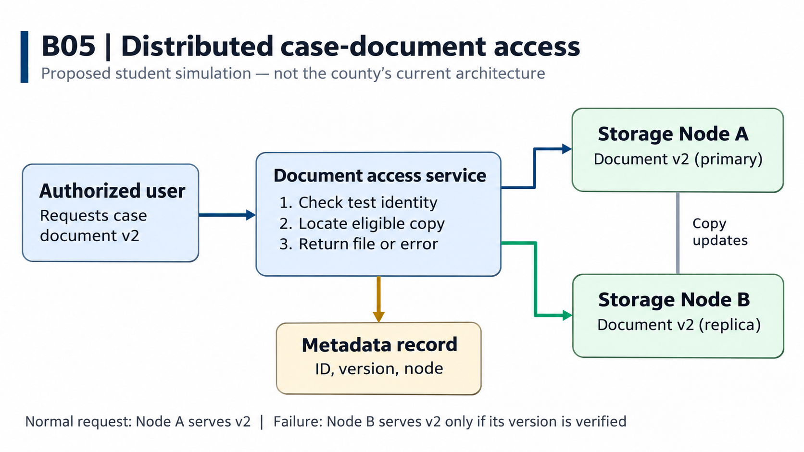

# B05 – Distributed Criminal Case Document Access and Failure Recovery

Student: Kapil Tamang  
Project: B05 – Resilient Case Management Services  
Last updated: November 8, 2026  
Document status: Assignment 1 draft

## Progress Note

I reviewed the Los Angeles County District Attorney's Office (LADA) case management system RFP and Chapters 1–4 of the course handbook. I identified the need for reliable document access in an environment with multiple case-management applications and narrowed my contribution to a small distributed document-retrieval service. This draft defines the users, a document request, one storage-node failure, and the boundaries of the project. I also reviewed PostgreSQL's high-availability documentation as a starting point for studying replication. My next step is to specify a repeatable retrieval test and compare normal retrieval with failover retrieval. The prototype and performance measurements are planned work, not completed results.

## Contents

1. [Problem research and scope](#1-problem-research-and-scope)
2. [Requirements and system specification](#2-requirements-and-system-specification)
3. [Alternatives and selected solution](#3-alternatives-and-selected-solution)
4. [Architectural design](#4-architectural-design)
5. [Component design and interfaces](#5-component-design-and-interfaces)
6. [Data structure design](#6-data-structure-design)
7. [Algorithm design and execution](#7-algorithm-design-and-execution)
8. [Failures and security](#8-failures-and-security)
9. [Implementation and feasibility](#9-implementation-and-feasibility)
10. [Testing and verification](#10-testing-and-verification)
11. [Operation, maintenance, and future work](#11-operation-maintenance-and-future-work)
12. [Revision history and references](#12-revision-history-and-references)

## 1. Problem Research and Scope

### Problem and Affected People

I am investigating how authorized staff can retrieve the correct criminal case document when different computer services are responsible for locating and storing files. At LADA, prosecutors, case intake clerks, and paralegals use case documents for filing preparation, case review, and hearings. A prosecutor who needs a police report before a hearing must be able to find and open the right version without unnecessary delay.

My project will investigate a focused distributed-systems capability: locating a document, retrieving it from an available storage node, and using another verified copy if the primary node fails. This addresses document availability and retrieval time rather than notifications or legal decisions.

### Stakeholders and Needs

| Stakeholder | Task | Need |
|---|---|---|
| Prosecutor | Retrieve case documents for hearings | Timely access to the correct version |
| Case intake clerk | Locate and organize case records | Reliable document identifiers and locations |
| Paralegal | Prepare supporting case materials | Dependable access to required files |
| IT administrator | Maintain document access services | Detect node failures and restore service |

### Current Workflow

LADA's official RFP-DA-IT01 describes its Prosecutor Information Management System (PIMS) and supporting tools, including eFolder, SharePoint, Notes/Domino, and eCER. The RFP identifies fragmented applications, duplicate data entry, and limited integration. It calls for a modern, integrated, cloud-based case management system. [1]

A typical document-access task involves identifying the case, locating its report or filing document in the relevant application, retrieving the file, and reviewing it for case work. My proposed project studies how this access task could work through independent services, especially when one storage service becomes unavailable.

### Concrete Scenario

Consider a fictional case, LADA-DEMO-104. A prosecutor requests police report DOC-104-01, version 2. In the proposed prototype, Storage Node A contains the primary document, while Storage Node B stores a replica. The Document Access Service receives the request and uses document metadata to locate the file.

During normal operation, the service retrieves version 2 from Node A and returns it to the prosecutor. If Node A stops responding, the service attempts to retrieve the document from Node B. When Node B holds a complete, verified version 2, the request can still succeed. If it holds only version 1, the system reports that the required version is unavailable rather than returning the wrong file.

This student test scenario illustrates a partial failure: one service stops working while the remaining services continue. It provides a concrete way to investigate availability, replication, version consistency, and retrieval delay.

### Workflow Image

*Figure 1. Proposed distributed document access workflow. The access service uses metadata to locate the file, retrieves it from Node A during normal operation, and attempts verified retrieval from Node B when Node A is unavailable. This diagram shows the proposed student prototype.*

### Evidence and Existing Approach

The LADA RFP establishes a real need to modernize and integrate case-management applications. Its discussion of PIMS, eFolder, and other separate tools provides the organizational setting for investigating dependable access to case information. [1]

PostgreSQL's official high-availability documentation describes replication and standby database techniques. [2] I will study these ideas while distinguishing database metadata replication from copying actual PDF files. For the prototype, I propose two independent file-storage services and a metadata store that records document IDs, versions, and locations. This is the design to be tested, not a description of LADA's deployed infrastructure.

### Six-Week Contribution (Semester I)

I will focus on one operation: retrieving one requested document version from an available storage node. My initial scope includes one simulated authorized user, a small set of fictional PDF documents, one Document Access Service, one metadata database, and two independently running storage services.

I will describe normal retrieval and a primary-node failure, define the expected result for each case, and plan measurements of retrieval time and version correctness. A small proof of concept may be developed during the semester. The goal is a testable, manageable design rather than a complete case-management platform.

### Semester II Scope

In Semester II, I plan to implement the retrieval service and two storage nodes, maintain test-document replicas, simulate node failures, and compare a single-node baseline with a replicated approach. I will measure total retrieval latency, failover delay, successful retrieval rate, replica-update delay, and whether the required version was returned. These experiments will show the performance and reliability tradeoffs of the proposed prototype.

### Exclusions

- The project will focus on document storage, retrieval, replication, and failure recovery rather than developing a complete case management system.
- The initial prototype will use simulated criminal case documents instead of confidential records.
- Direct integration with external court systems, police databases, and other government agencies is outside the initial scope.
- Legal decision-making, case prosecution workflows, and other administrative functions will not be implemented.
- Large-scale deployment and advanced disaster recovery will be considered future extensions rather than part of the initial prototype.

## 2. Requirements and System Specification

Work to come — Assignment 2. Define request inputs, expected responses, version rules, and measurable success criteria.

## 3. Alternatives and Selected Solution

Work to come — Assignments 2–3. Compare a single-node baseline with verified retrieval from replicated storage.

## 4. Architectural Design

Work to come — Assignment 3. Specify services, communication paths, and deployment boundaries.

## 5. Component Design and Interfaces

Work to come — Assignment 3. Define component responsibilities, interface messages, and error responses.

## 6. Data Structure Design

Work to come — Assignment 4. Define document metadata, version identifiers, checksums, and file locations.

## 7. Algorithm Design and Execution

Work to come — Assignment 4. Describe normal retrieval, timeout, failover, and version verification.

## 8. Failures and Security

Work to come — Assignment 4. Examine failed nodes, stale replicas, access restrictions, and recovery limits.

## 9. Implementation and Feasibility

Work to come — Assignments 3–6. Record development setup, prototype implementation, and feasibility findings.

## 10. Testing and Verification

Work to come — Assignments 4–6. Define repeatable experiments and report measured results.

## 11. Operation, Maintenance, and Future Work

Work to come — Assignments 4–6. Describe service monitoring, recovery procedures, and Semester II milestones.

## 12. Revision History and References

### Revision History

| Revision date | Change to my design | Reason |
|---|---|---|
| November 8, 2026 | Defined the users, document retrieval workflow, failure scenario, and bounded Semester I contribution | Assignment 1, informed by LADA RFP-DA-IT01 and distributed-systems concepts |

### Open Question

| Question | Why it matters | Next action |
|---|---|---|
| When Node A fails, how can the service confirm that Node B has the required document version without adding too much retrieval delay? | A fast response is not useful if it returns an outdated file. | Study version metadata and checksums, then compare retrieval under normal and failure conditions. |

### References

1. Los Angeles County District Attorney's Office. *RFP-DA-IT01 — Case Management System (CMS) Solution*. September 29, 2026. Sections 2.1, 2.2, and 3.0.  
   https://camisvr.co.la.ca.us/LACoBids/BidLookUp/BidDetail?BidNumber=RFP-DA-IT01

2. PostgreSQL Documentation. *High Availability, Load Balancing, and Replication*.  
   https://www.postgresql.org/docs/current/high-availability.html

3. GitHub Docs. *Basic Writing and Formatting Syntax*.  
   https://docs.github.com/en/get-started/writing-on-github/getting-started-with-writing-and-formatting-on-github/basic-writing-and-formatting-syntax

4. Course handbook. *Chapters 1–4: Distributed Systems and Software Design Foundations*. Instructor-provided reading.
