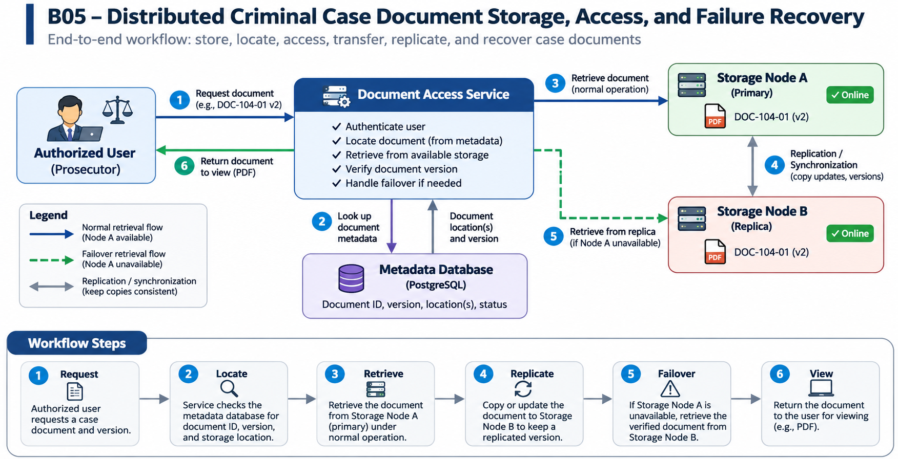

# B05 – Distributed Criminal Case Document Storage, Access, and Failure Recovery

Student: Kapil Tamang  
Project: B05 – Resilient Case Management Services  
Last updated: November 9, 2026  
Document status: Assignment 1 draft

## Progress Note

I reviewed the Los Angeles County District Attorney's Office (LADA) case management system Request for Proposals (RFP) and Chapters 1–4 of the course handbook. I identified the need to investigate dependable document access across multiple applications and narrowed my contribution to document storage, location, retrieval, transfer, replication, and failure recovery. I identified the stakeholders, developed a fictional case scenario, and created a workflow image. I also reviewed PostgreSQL's high-availability documentation. My next step is to define measurable requirements for retrieval, transfer time, and version correctness. The prototype and experiments are planned work, not completed results.

## Contents

1. [Problem research and scope](#1-problem-research-and-scope)
2. [Requirements and system specification](#2-requirements-and-system-specification)
3. [Alternatives and selected solution](#3-alternatives-and-selected-solution)
4. [Architectural design](#4-architectural-design)
5. [Component design and interfaces](#5-component-design-and-interfaces)
6. [Data structure design](#6-data-structure-design)
7. [Algorithm design and execution](#7-algorithm-design-and-execution)
8. [Failures and security](#8-failures-and-security)
9. [Implementation and feasibility](#9-implementation-and-feasibility)
10. [Testing and verification](#10-testing-and-verification)
11. [Operation, maintenance, and future work](#11-operation-maintenance-and-future-work)
12. [Revision history and references](#12-revision-history-and-references)

## 1. Problem Research and Scope

### Problem and Affected People

I am investigating how criminal case documents can be stored, located, accessed, viewed, and transferred across independent servers. At LADA, prosecutors, case intake clerks, and paralegals need police reports and other case documents for filing preparation, case review, and hearings. They need timely access to the correct document version.

My project focuses on where a document is stored on a server, how its location is recorded, how authorized users retrieve and view it, and how long retrieval and transfer take. I will also investigate how document copies are kept up to date and how a verified copy can be retrieved if the primary storage node fails. Failure recovery is one part of the complete storage-to-viewing workflow.

### Stakeholders and Needs

| Stakeholder | Task | Need |
|---|---|---|
| Prosecutor | Retrieve documents for hearings | Timely access to the correct version |
| Case intake clerk | Store and organize records | Reliable document IDs and storage locations |
| Paralegal | Prepare supporting case materials | Dependable access to required files |
| IT administrator | Maintain document access services | Detect failures and restore access |

### Current Workflow

LADA's official RFP-DA-IT01 describes its Prosecutor Information Management System (PIMS) and supporting tools, including eFolder, SharePoint, Notes/Domino, and eCER. The RFP identifies fragmented applications, duplicate data entry, and limited integration, and calls for a modern, integrated case management system. [1]

A typical task involves identifying a case, finding its document in the appropriate application, retrieving it, and reviewing it. My proposed design examines the full process through independent services: store the PDF on a node, record its ID and location, retrieve it for viewing, measure transfer time, maintain another copy, and recover access if a node becomes unavailable. This is a student design, not a description of LADA's current storage architecture.

### Concrete Scenario

Consider fictional case LADA-DEMO-104. Police report DOC-104-01, version 2, is stored on Storage Node A, with a replicated copy on Storage Node B. In the prototype, the file could be saved under a path such as `cases/LADA-DEMO-104/DOC-104-01/v2.pdf`. A metadata database records its document ID, version, checksum, and storage locations.

A prosecutor requests the report. The Document Access Service checks the simulated user's authorization, locates the document through metadata, retrieves it from Node A, and returns the PDF for viewing. I plan to measure the retrieval time and the time required to copy updates to Node B.

If Node A stops responding, the service tries Node B. When Node B has a complete, verified version 2, the request can succeed. If it has only version 1, the service reports that the required version is unavailable rather than returning an outdated report. This scenario connects storage, location, access, transfer, replication, version correctness, and failure recovery.

### Workflow Image

*Figure 1. Proposed distributed document workflow. The access service uses metadata to locate the file, retrieves it from Node A during normal operation, and returns it for viewing. Node B stores a replica and can provide a verified copy if Node A is unavailable. This is a student prototype, not LADA's current infrastructure.*

### Evidence and Existing Approach

The LADA RFP establishes a need to modernize and integrate case-management applications. Its discussion of PIMS, eFolder, and related tools provides the real-world setting for investigating dependable access to case documents. [1]

PostgreSQL's high-availability documentation describes database replication and standby techniques. [2] I will study these ideas while distinguishing metadata replication from copying actual PDFs. My proposed system uses a Document Access Service, a metadata database for IDs, versions, and locations, and two file-storage nodes.

### Six-Week Contribution (Semester I)

I will investigate and design one small document workflow: store a fictional PDF, record its location, retrieve and view the requested version, transfer an updated copy to another node, and handle a primary-node failure. The scope includes one simulated authorized user, a small set of fictional PDFs, one Document Access Service, one metadata database, and two storage services.

I will define expected results for normal retrieval, replica updates, and node failure, and plan measurements for retrieval time, transfer time, replication delay, and version correctness. A small proof of concept may be developed if time permits. The goal is a manageable, testable design, not a complete case-management system.

### Semester II Scope

In Semester II, I plan to implement the Document Access Service and two storage nodes, store and replicate fictional PDFs, and simulate a node failure. I will compare a single-node baseline with the replicated design using different file sizes. I plan to measure retrieval latency, file transfer time, replica-update delay, failover delay, successful retrieval rate, and document-version correctness to evaluate performance and reliability tradeoffs.

### Exclusions

- The project focuses on document storage, location, viewing, retrieval, transfer, replication, and failure recovery rather than a complete case management system.
- The prototype will use fictional PDF documents instead of confidential criminal case records.
- Direct integration with courts, police databases, and government production systems is outside the initial scope.
- Legal decision-making, prosecution workflows, victim notifications, and other administrative functions will not be implemented.
- Large-scale production deployment and advanced disaster recovery are future possibilities, not part of the initial prototype.

2. Requirements and Success Criteria

    Work to come in a later assignment.

    This section will define formal requirements and measurable acceptance criteria for document retrieval, availability, version correctness, and response time.

3. Existing Approaches and Comparison

    Work to come in a later assignment.

    This section will compare a basic single-node storage approach with a two-node replicated approach to examine the differences in availability, performance, and reliability.

4. System Architecture

    Work to come in a later assignment.

    This section will describe the placement of the Document Access Service, metadata database, storage nodes, and communication interfaces in greater detail.

5. Component Responsibilities

    Work to come in a later assignment.

    This section will explain the responsibilities of individual services and describe how they communicate during document requests and storage failures.

6. Data Structures and Persistent Storage

    Work to come in a later assignment.

    This section will define document identifiers, version records, storage locations, checksums, and persistent metadata structures.

7. Algorithms and Pseudocode

    Work to come in a later assignment.

    This section will describe the document retrieval process, storage-node failure detection, replica selection, and version verification.

8. Implementation Plan

    Work to come in a later assignment.

    This section will explain the proposed software technologies, development environment, implementation steps, and milestones.

9. Testing and Evaluation

    Work to come in a later assignment.

    This section will define formal testing procedures for retrieval latency, network delays, storage-node failures, replication delays, and document-version correctness.

10. Risks, Limitations, and Security

    Work to come in a later assignment.

    This section will discuss authorization, document integrity, confidentiality, system availability, and the limitations of the local simulation.

11. Progress Note and Open Question

    Progress Note – November 6, 2026

    For Assignment 1, I read Chapters 1-4 of the course handbook and studied the Los Angeles County District Attorney's Office RFP-DA-IT01. This RFP enabled me to establish a problem documented in terms of a fragmented legacy case management application and a lack of integration between these systems.

    Originally, I was contemplating pursuing a more general case management project, but I decided to concentrate on a single specific distributed systems problem of obtaining a right document from the primary storage system.

    My main stakeholders were prosecutors and authorized case support staff, and I created a fictional scenario about obtaining a document by a prosecutor with a storage node failure.

    I additionally proposed an architecture that includes a Document Access Service, metadata database, and two separate storage nodes. The first workflow shows how documents can be found and retrieved under normal conditions as well as how retrieval can be attempted from a different node in case the main node fails.

    I defined the personal contributions for Semester I, the implementation goal for Semester II, and the project exclusions.

    So far, I have performed the initial problem investigation and set the project boundaries. I have not implemented the system and measured its performance.  

    Open Problem

    In a scenario where Storage Node A is down, what mechanism would allow the Document Access Service to ascertain that Storage Node B actually holds the most recent version of a case document and not an old replica?

    This issue is significant in light of the fact that storing multiple versions of the document can enhance availability, but the documents may not have identical versions.

    For example, if Node A crashes before replication occurs, Node B may actually hold an old version of the document. Using this version to provide the document will yield an erroneous answer.

    What I have to do is learn more about document versioning, integrity checking, and replica selection.

12. Sources and Existing Approaches

    Source 1: Los Angeles County District Attorney's Office

    Title: Request for Proposals RFP-DA-IT01 – Case Management System Solution

    Publication Date: September 29, 2026

    Relevant Sections: 2.1, 2.2, and 3.0

    Link: https://camisvr.co.la.ca.us/LACoBids/BidLookUp/BidDetail?BidNumber=RFP-DA-IT01

    This is the primary source for the real-world problem. The RFP describes LADA's legacy case management environment, supporting applications such as PIMS and eFolder, fragmented information systems, and integration difficulties.

    It also establishes the county's interest in implementing a modern, cloud-based case management system and identifies performance, integration, and disaster recovery as important concerns.

    The RFP provides evidence of the organizational need but does not directly establish the storage-node failure described in my hypothetical scenario.

    Source 2: PostgreSQL Documentation

    Topic: High Availability, Load Balancing, and Replication

    Link: https://www.postgresql.org/docs/current/high-availability.html

    The documentation outlines the current methods for database replication and high availability. It provides some insight into how persistent information can be duplicated between systems and the role of standby systems in recovery.

    Database replication using PostgreSQL is distinct from PDF replication. My proposed prototype will use PostgreSQL for document metadata while exploring PDF replication.

    Source 3: Course Handbook

    Name of source: Chapters 1-4 – Distributed Systems & Software Design Fundamentals

    Source: Class materials provided by the professor.

    These chapters cover communicating processes, client/server systems, persistence of data, partial failures, software design, Markdown for documentation, evidence labels, and narrowing down the scope of a student project.
