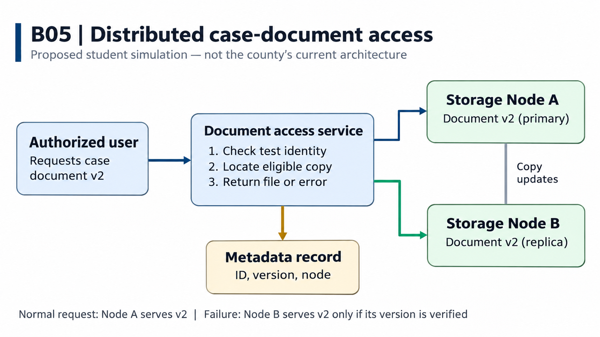
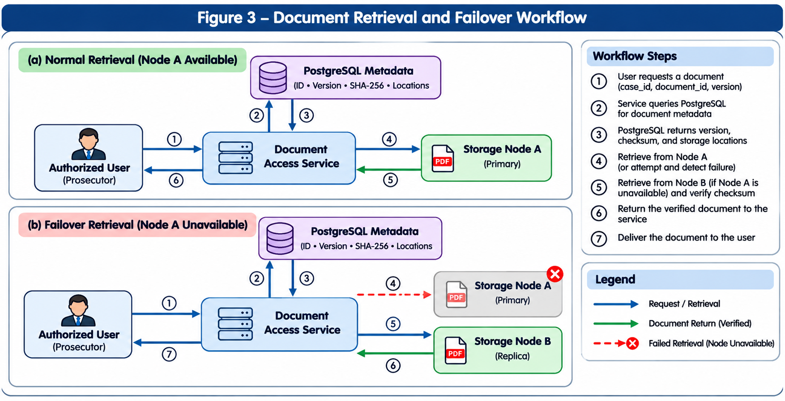

# B05 – Distributed Criminal Case Document Storage, Access, and Failure Recovery

Student: Kapil Tamang  
Project: B05 – Resilient Case Management Services  
Last updated: November 9, 2026  
Document status: Assignment 1 draft

## Progress Note

 I expanded the requirements for my distributed criminal case document storage and retrieval project. I defined five functional requirements covering document storage, retrieval, replication, failure recovery, and invalid requests. I also added correctness rules and proposed measurable targets for retrieval time, replication time, and failover performance. Using my workflow diagram, I compared a simple single-node storage approach with a two-node replicated approach to identify their differences in availability, performance, and complexity. I reviewed the LADA case management system RFP and PostgreSQL's high-availability documentation to support the project context and comparison. My next step is to evaluate the alternatives further and select a final design in Assignment 3. Implementation and performance testing have not yet been completed.

## Contents

1. [Problem research and scope](#1-problem-research-and-scope)
2. [Requirements and system specification](#2-requirements-and-system-specification)
3. [Alternatives and selected solution](#3-alternatives-and-selected-solution)
4. [Architectural design](#4-architectural-design)
5. [Component design and interfaces](#5-component-design-and-interfaces)
6. [Data structure design](#6-data-structure-design)
7. [Algorithm design and execution](#7-algorithm-design-and-execution)
8. [Failures and security](#8-failures-and-security)
9. [Implementation and feasibility](#9-implementation-and-feasibility)
10. [Testing and verification](#10-testing-and-verification)
11. [Operation, maintenance, and future work](#11-operation-maintenance-and-future-work)
12. [Revision history and references](#12-revision-history-and-references)

## 1. Problem Research and Scope

### Problem and Affected People

I am investigating how criminal case documents can be stored, located, accessed, viewed, and transferred across independent servers. At LADA, prosecutors, case intake clerks, and paralegals need police reports and other case documents for filing preparation, case review, and hearings. They need timely access to the correct document version.

My project focuses on where a document is stored on a server, how its location is recorded, how authorized users retrieve and view it, and how long retrieval and transfer take. I will also investigate how document copies are kept up to date and how a verified copy can be retrieved if the primary storage node fails. Failure recovery is one part of the complete storage-to-viewing workflow.

### Stakeholders and Needs

| Stakeholder | Task | Need |
|---|---|---|
| Prosecutor | Retrieve documents for hearings | Timely access to the correct version |
| Case intake clerk | Store and organize records | Reliable document IDs and storage locations |
| Paralegal | Prepare supporting case materials | Dependable access to required files |
| IT administrator | Maintain document access services | Detect failures and restore access |

### Current Workflow

LADA's official RFP-DA-IT01 describes its Prosecutor Information Management System (PIMS) and supporting tools, including eFolder, SharePoint, Notes/Domino, and eCER. The RFP identifies fragmented applications, duplicate data entry, and limited integration, and calls for a modern, integrated case management system. [1]

A typical task involves identifying a case, finding its document in the appropriate application, retrieving it, and reviewing it. My proposed design examines the full process through independent services: store the PDF on a node, record its ID and location, retrieve it for viewing, measure transfer time, maintain another copy, and recover access if a node becomes unavailable. This is a student design, not a description of LADA's current storage architecture.

### Concrete Scenario

Consider fictional case LADA-DEMO-104. Police report DOC-104-01, version 2, is stored on Storage Node A, with a replicated copy on Storage Node B. In the prototype, the file could be saved under a path such as `cases/LADA-DEMO-104/DOC-104-01/v2.pdf`. A metadata database records its document ID, version, checksum, and storage locations.

A prosecutor requests the report. The Document Access Service checks the simulated user's authorization, locates the document through metadata, retrieves it from Node A, and returns the PDF for viewing. I plan to measure the retrieval time and the time required to copy updates to Node B.

If Node A stops responding, the service tries Node B. When Node B has a complete, verified version 2, the request can succeed. If it has only version 1, the service reports that the required version is unavailable rather than returning an outdated report. This scenario connects storage, location, access, transfer, replication, version correctness, and failure recovery.

### Workflow Image

*Figure 1. Proposed distributed document workflow. The access service uses metadata to locate the file, retrieves it from Node A during normal operation, and returns it for viewing. Node B stores a replica and can provide a verified copy if Node A is unavailable. This is a student prototype, not LADA's current infrastructure.*

### Evidence and Existing Approach

The LADA RFP establishes a need to modernize and integrate case-management applications. Its discussion of PIMS, eFolder, and related tools provides the real-world setting for investigating dependable access to case documents. [1]

PostgreSQL's high-availability documentation describes database replication and standby techniques. [2] I will study these ideas while distinguishing metadata replication from copying actual PDFs. My proposed system uses a Document Access Service, a metadata database for IDs, versions, and locations, and two file-storage nodes.

### Six-Week Contribution (Semester I)

I will investigate and design one small document workflow: store a fictional PDF, record its location, retrieve and view the requested version, transfer an updated copy to another node, and handle a primary-node failure. The scope includes one simulated authorized user, a small set of fictional PDFs, one Document Access Service, one metadata database, and two storage services.

I will define expected results for normal retrieval, replica updates, and node failure, and plan measurements for retrieval time, transfer time, replication delay, and version correctness. A small proof of concept may be developed if time permits. The goal is a manageable, testable design, not a complete case-management system.

### Semester II Scope

In Semester II, I plan to implement the Document Access Service and two storage nodes, store and replicate fictional PDFs, and simulate a node failure. I will compare a single-node baseline with the replicated design using different file sizes. I plan to measure retrieval latency, file transfer time, replica-update delay, failover delay, successful retrieval rate, and document-version correctness to evaluate performance and reliability tradeoffs.

### Exclusions

- The project focuses on document storage, location, viewing, retrieval, transfer, replication, and failure recovery rather than a complete case management system.
- The prototype will use fictional PDF documents instead of confidential criminal case records.
- Direct integration with courts, police databases, and government production systems is outside the initial scope.
- Legal decision-making, prosecution workflows, victim notifications, and other administrative functions will not be implemented.
- Large-scale production deployment and advanced disaster recovery are future possibilities, not part of the initial prototype.

## 2. Requirements and System Specification

### System Overview

The proposed system will allow authorized users to store, locate, retrieve, and view criminal case documents across independent storage nodes. The Document Access Service will communicate with a PostgreSQL metadata database to identify document IDs, versions, checksums, and storage locations.

Under normal operation, the system will retrieve documents from Storage Node A. Storage Node B will maintain a replicated copy that can be used when the primary storage node becomes unavailable. The system must verify that the retrieved document matches the requested version before returning it to the user.

The following requirements define the expected behavior of the proposed prototype. All performance targets are proposed and have not yet been measured.

### Functional Requirements

| Requirement ID | Requirement | Acceptance Check |
|---|---|---|
| FR-01 | The system shall store a fictional PDF on Storage Node A and record its document ID, version, checksum, and storage location in the metadata database. | Upload `DOC-104-01` version 2 and verify that the PDF exists on Node A and its metadata record contains the correct information. |
| FR-02 | The system shall allow an authorized user to request a document by ID and version and retrieve it from an available storage node. | Request `DOC-104-01` version 2 while Node A is online. Verify that the requested PDF is returned and can be viewed. |
| FR-03 | The system shall transfer document updates from Storage Node A to Storage Node B and verify that the replicated copy is complete. | Store version 2 on Node A, replicate it to Node B, and compare the document version and checksum on both nodes. |
| FR-04 | The system shall retrieve a verified document from Storage Node B when Storage Node A becomes unavailable. | Stop Node A and request version 2. Verify that Node B supplies the correct document when an identical verified copy exists. |
| FR-05 | The system shall reject unauthorized document requests and report an error when the requested document or correct version is unavailable. | Test an unauthorized user and request version 2 when only version 1 is available. Verify that neither request returns a document. |

### Correctness Rules

**CR-01 – Document Version Correctness**

The system must return only the document version requested by the authorized user. A document is valid for retrieval only when its ID, version, and checksum match the information recorded in the metadata database.

For example, if a prosecutor requests `DOC-104-01` version 2 and Storage Node B contains only version 1, the system must not return version 1 as a replacement. Instead, it must report that the requested version is unavailable.

**CR-02 – Replica Integrity**

A replicated document must match the original document's content before it is marked as verified. The system will use a SHA-256 checksum to compare the original PDF with its replicated copy. If the checksums do not match, the replica must not be returned as a valid document.

### Measurable Quality Targets

The following values are proposed targets for a small prototype running on a controlled local test environment. They are not measured performance results.

| Quality ID | Quality Target (Proposed) | Measurement and Acceptance Check |
|---|---|---|
| QT-01 | Normal document retrieval should complete within 2 seconds for a 1 MB PDF. | Perform 20 requests while Node A is online and measure the time from request submission until the full PDF is received. At least 19 should complete within 2 seconds. |
| QT-02 | Replication of a 1 MB PDF should complete within 3 seconds. | Perform 20 replication operations and measure the time from the start of the transfer until Node B has a verified copy. At least 19 should complete within 3 seconds. |
| QT-03 | Retrieval through Node B after Node A becomes unavailable should complete within 5 seconds. | Perform 20 requests with Node A intentionally unavailable and a verified copy already on Node B. At least 19 should complete within 5 seconds. |
| QT-04 | Every successful retrieval must return the requested document version with a matching checksum. | Test normal retrieval, failover retrieval, and outdated-replica cases. No test may return an incorrect document as successful. |

### Ordinary Input and Output Example

**Normal Operation**

Input:

- User: Authorized Prosecutor
- Case ID: `LADA-DEMO-104`
- Document ID: `DOC-104-01`
- Requested version: 2
- Storage Node A: Available
- Storage Node B: Available

Expected Output:

- Status: Success
- Document: `DOC-104-01` version 2
- Retrieved from: Storage Node A
- Verification: Version and checksum match
- Result: PDF returned for viewing

The Document Access Service authenticates the simulated user, searches the metadata database, identifies the correct storage location, and retrieves the requested document from Node A.

### Unsuccessful Case

Input:

- User: Authorized Prosecutor
- Document ID: `DOC-104-01`
- Requested version: 2
- Storage Node A: Unavailable
- Storage Node B: Contains only version 1

Expected Output:

- Status: Document unavailable
- Reason: Requested version 2 is not available on a verified storage node
- Result: No document returned

The service must not return version 1 because it does not match the requested version. This test checks whether the system preserves document correctness during a storage-node failure.

### Assumptions

The prototype assumes that a small collection of fictional PDF documents will be used for testing. The Document Access Service will communicate with two independently operated storage services over a simulated or local network. PostgreSQL will store document metadata, including document IDs, versions, checksums, and storage locations.

User authorization will be simulated rather than connected to a real government identity system. The initial tests assume that the metadata database and Document Access Service remain available while individual storage-node failures are introduced. Replication will be tested after each document update, and a copy will be considered valid only after verification.

### Constraints

The system will use one Document Access Service, one PostgreSQL metadata database, and two storage nodes. All documents will be fictional, and no confidential criminal case information will be used.

The project will focus on storage, retrieval, document transfer, replication, version correctness, and recovery from a storage-node failure. It will not implement an entire criminal case management system or integrate directly with government databases.

A failure of the metadata database, simultaneous failure of both storage nodes, automatic conflict resolution for concurrent updates, and large-scale disaster recovery are outside the initial prototype scope.

The performance measurements will depend on the test environment, file sizes, and simulated network conditions. The proposed targets may be revised after initial experiments.

## 3. Alternatives and Selected Solution

### Overview

This section compares two possible approaches for storing, retrieving, and recovering criminal case documents across storage servers. The first approach uses a single storage node as a simple baseline. The second approach uses two independent storage nodes with replication and failure recovery.

Both approaches are compared against the requirements defined in Section 2, including document storage, retrieval, version correctness, transfer time, and availability during a storage-node failure.

After evaluating both approaches, I selected the two-node replicated storage approach because it supports document availability and recovery when the primary storage node becomes unavailable.

### Approach 1: Single-Node Document Storage (Baseline)

The first approach stores all fictional criminal case documents on one storage node. The Document Access Service uses the PostgreSQL metadata database to locate the requested PDF and retrieve it from that node.

When an authorized prosecutor requests a document, the service checks the metadata database, identifies the correct document version, retrieves the file, verifies its checksum, and returns it for viewing.

This approach is simple to implement because it requires only one storage location. It also avoids the additional work of transferring files between servers and keeping replicated copies synchronized.

However, if the storage node becomes unavailable, the system cannot retrieve the document. Even if the metadata database remains operational, the actual PDF remains inaccessible until the storage node is restored.

This approach provides a useful baseline for measuring normal retrieval performance, but it does not satisfy the replication and failure-recovery requirements.

### Approach 2: Two-Node Replicated Document Storage

The second approach stores the original document on Storage Node A and maintains a replicated copy on Storage Node B.

The Document Access Service retrieves document locations and versions from PostgreSQL. During normal operation, it retrieves the requested PDF from Node A. When a document is updated, the system transfers a copy to Node B and verifies that the replicated content matches the original.

If Node A becomes unavailable, the service attempts to retrieve the requested document from Node B. Before returning the PDF, it verifies that the document ID, version, and checksum match the requested information.

This approach provides an alternative storage location when the primary node fails. It also allows the prototype to measure replication time, document transfer time, and retrieval performance during normal operation and failure recovery.

However, replication introduces additional complexity. Document updates must be transferred correctly, both copies must remain consistent, and the system must avoid returning outdated or incomplete files.

For example, if Node A contains version 2 but Node B contains only version 1, the system must not return version 1 when version 2 is requested. Instead, it must report that the requested version is unavailable.

### Comparison of the Two Approaches

| Evaluation Criteria | Approach 1: Single Node | Approach 2: Two Nodes |
|---|---|---|
| FR-01: Document storage and metadata | Supported | Supported |
| FR-02: Authorized document retrieval | Supported while node is available | Supported while a valid copy is available |
| FR-03: Document replication | Not supported | Supported by design |
| FR-04: Recovery from primary-node failure | Not supported | Supported if Node B has a verified copy |
| FR-05: Invalid and unauthorized request handling | Can be implemented | Can be implemented |
| CR-01: Correct document version | Can be checked | Requires checking primary and replica versions |
| CR-02: Replica integrity | Not applicable | Requires checksum verification |
| QT-01: Normal retrieval within 2 seconds | To be measured | To be measured |
| QT-02: Replication within 3 seconds | Not supported | To be measured |
| QT-03: Failover retrieval within 5 seconds | Not supported | To be measured |
| QT-04: Version and checksum correctness | Can be tested for normal retrieval | Can be tested for normal and failover retrieval |
| Implementation complexity | Lower | Higher |
| Availability during Node A failure | Document unavailable | Document may be available through Node B |

### Evaluation Plan

Both approaches will be tested using the same fictional PDF documents and the same local test environment. Initial tests will use 1 MB PDF files, with additional file sizes considered during Semester II.

For the single-node approach, I will store a document, record its metadata, retrieve the requested version, and measure retrieval time. I will then stop the storage node and attempt to retrieve the document again to observe the failure behavior.

For the two-node approach, I will repeat the normal retrieval test and then transfer the document to Storage Node B. I will verify that both copies contain the same version and matching checksums.

After replication, I will stop Storage Node A and request the document again. The system should retrieve the verified copy from Storage Node B when available.

The experiments will measure document retrieval latency, file transfer time, replication delay, failover retrieval time, and version correctness. These measurements will help determine whether the additional complexity of replication provides sufficient benefits.

### Evidence Supporting the Approaches

The Los Angeles County District Attorney's Office RFP-DA-IT01 describes the need to modernize and integrate its case management applications. This provides the real-world motivation for investigating reliable access to criminal case documents across separate services. The proposed storage architecture is a student design rather than a description of LADA's existing infrastructure. [1]

PostgreSQL's high-availability documentation describes replication, standby servers, and failure recovery in database systems. These concepts help explain how additional copies and recovery mechanisms can improve availability while introducing synchronization challenges. [2]

In this project, PostgreSQL will store document metadata, including document IDs, versions, checksums, and locations. The actual PDF files will be copied between storage services separately. PostgreSQL database replication alone does not automatically replicate externally stored PDF files.

### Selected Solution and Justification

I selected Approach 2: Two-Node Replicated Document Storage for my proposed system.

The main reason for this choice is that the two-node approach supports the functional requirements for document replication (FR-03) and failure recovery (FR-04). Unlike the single-node approach, it provides another storage location when the primary node becomes unavailable.

The proposed design also supports document version correctness (CR-01) and replica integrity (CR-02) by verifying document versions and SHA-256 checksums before returning files.

Although the two-node approach requires additional implementation work, it better supports my project goal of dependable document access.

The single-node approach will remain a baseline for measuring normal retrieval performance and comparing the reliability of the two designs.

### Decision Record DR-01: Storage Architecture and Failure Recovery

**Context:**

Authorized prosecutors and case support staff need access to the correct criminal case documents even when the primary storage node becomes unavailable.

**Options:**

1. Single-node document storage.
2. Two-node document storage with replication and failure recovery.

**Choice:**

I selected two-node replicated document storage, using Storage Node A as the primary node and Storage Node B as the replica.

**Reasons:**

The two-node approach satisfies FR-03 and supports FR-04 by maintaining another document copy that can be retrieved when the primary node fails.

It also allows the system to measure replication time, failover retrieval time, and document availability.

**Consequences:**

This choice requires additional storage space, replication logic, file verification, and failure handling.

The system must also prevent outdated or incomplete replicas from being returned to users.

**Conditions for Reconsideration:**

I will reconsider the design if replication consistently fails the proposed performance targets, if synchronization problems cannot be handled correctly, or if implementation complexity exceeds the project scope.

### Decision Record DR-02: Document Version and Integrity Verification

**Context:**

Storage Node A and Storage Node B may contain different versions of a document because replication takes time or a transfer may fail.

Returning an outdated or corrupted document could create problems for prosecutors preparing case materials.

**Options:**

1. Retrieve any available document copy without additional verification.
2. Verify the requested document version and SHA-256 checksum using PostgreSQL metadata.

**Choice:**

I selected document version and checksum verification using PostgreSQL metadata and SHA-256.

**Reasons:**

This approach supports CR-01 and CR-02 by ensuring that a retrieved document matches the requested version and expected file contents.

For example, if the user requests version 2 but Node B only contains version 1, the service must reject the outdated copy instead of returning it.

**Consequences:**

The Document Access Service must perform metadata lookups and checksum verification before returning a PDF.

This adds processing work but reduces the risk of returning an incorrect document.

**Conditions for Reconsideration:**

If checksum verification causes excessive retrieval delays, I will investigate more efficient verification methods while preserving document correctness.

### Final Design Assessment

The single-node approach is easier to implement and remains useful as a baseline. However, it cannot provide document access when its only storage node fails.

The selected two-node replicated approach provides an alternative retrieval location and better supports the functional requirements for replication, version correctness, and failure recovery.

A verified replica can be returned when Node A becomes unavailable, but the system must report an error if Node B does not contain the requested version.

The final design will use a Document Access Service, PostgreSQL metadata database, Storage Node A, and Storage Node B.

The architecture, component responsibilities, and communication interfaces for this selected solution are described in Sections 4 and 5. The implementation plan and feasibility experiment are described in Section 9.

The proposed retrieval, replication, and failover performance targets have not yet been fully measured.

## 4. Architectural Design

### System Context

The proposed system contains an authorized user, a Document Access Service, a PostgreSQL metadata database, and two independent storage nodes.

An authorized prosecutor requests a criminal case document through the Document Access Service. The service checks authorization, queries PostgreSQL for the document information, and retrieves the requested PDF.

Under normal operation, the document is retrieved from Storage Node A. If Node A becomes unavailable, the system attempts retrieval from Storage Node B.

The retrieved document is verified before being returned to the user.

### System Architecture Diagram

*Figure 2. Proposed distributed document storage architecture showing the Document Access Service, PostgreSQL metadata database, Storage Node A, Storage Node B, replication, and failover.*

### Architecture Components

| Component | Responsibility | Stored State | Deployment |
|---|---|---|---|
| Authorized User | Requests and views documents | No permanent document storage | Test client |
| Document Access Service | Handles authorization, retrieval, verification, and failover | Temporary request data and logs | Python application |
| PostgreSQL Database | Stores document IDs, versions, checksums, and storage locations | Persistent metadata | Database service |
| Storage Node A | Stores primary PDF documents | Original PDF files | Storage service A |
| Storage Node B | Stores replicated PDF documents | Replicated PDF files | Storage service B |
| Replication Worker | Copies updates and verifies replicas | Transfer status | Background process in the prototype |

### Communication Between Components

The authorized user sends an HTTP request to the Document Access Service.

The Document Access Service communicates with PostgreSQL using database queries to locate the document and identify its expected version and checksum.

The service communicates with storage nodes to retrieve the requested PDF. The replication process transfers document files from Node A to Node B.

If Node A becomes unavailable, the service attempts to retrieve a verified copy from Node B.

### Document Retrieval and Failover Diagram

*Figure 3. Proposed retrieval workflow showing normal document access, failure recovery, and version verification.*

### Document Retrieval Workflow

1. An authorized prosecutor requests document DOC-104-01, version 2.

2. The Document Access Service checks the user's simulated authorization.

3. The service queries PostgreSQL for the document ID, version, checksum, and storage locations.

4. During normal operation, the service retrieves the PDF from Storage Node A.

5. If Node A is unavailable, the service attempts retrieval from Storage Node B.

6. The retrieved document's version and SHA-256 checksum are verified against the metadata record.

7. If verification succeeds, the PDF is returned. Otherwise, an error is reported.

This workflow supports FR-02, FR-04, CR-01, and CR-02.

### Deployment Architecture

The initial prototype will run on a local development computer using separate processes or containers.

The Document Access Service will run as a Python API application. PostgreSQL will run as a database service. Storage Node A and Storage Node B will operate as separate local storage services or directories.

This setup will simulate independent storage-node failures. However, running both storage nodes on one computer does not provide physical fault isolation.

### Build, Reuse, and Simulation

**Components to Build:**

- Document Access Service
- Document storage and retrieval operations
- Replication logic
- Checksum verification
- Failover handling
- Performance tests

**Components to Reuse:**

- PostgreSQL for metadata
- Python libraries for file handling
- SHA-256 hashing
- HTTP communication libraries

**Components to Simulate:**

- Authorized prosecutor
- Fictional criminal case PDF documents
- Primary storage-node failures
- Independent storage nodes in a local environment

### Architecture Limitations

The initial prototype assumes that PostgreSQL and the Document Access Service remain available during storage-node failure tests.

Simultaneous failures of both storage nodes, metadata database recovery, and large-scale disaster recovery are outside the initial scope.

Request timeouts, incomplete transfers, and concurrent document updates will be refined during implementation.

## 5. Component Design and Interfaces

### Component Responsibility Table

| Component | Main Responsibility | Related Requirements |
|---|---|---|
| Document Access Service | Authorizes requests, locates documents, verifies files, and handles failover | FR-02, FR-04, FR-05 |
| PostgreSQL Metadata Database | Stores document IDs, versions, checksums, and locations | FR-01, FR-02 |
| Storage Node A | Stores and provides primary PDF documents | FR-01, FR-02 |
| Storage Node B | Stores replicas and provides fallback retrieval | FR-03, FR-04 |
| Replication Worker | Transfers documents and verifies replicated copies | FR-03, CR-02 |
| Test Client | Simulates requests and checks responses | FR-02, FR-05 |

### Critical Operation: Retrieve Document

The critical operation is retrieving a specific document version from an available storage node.

**Endpoint:**

`GET /cases/{case_id}/documents/{document_id}/versions/{version}`

**Related Requirements:** FR-02, FR-04, FR-05, CR-01, and CR-02.

### Input Contract

| Input | Type | Example |
|---|---|---|
| Case ID | String | LADA-DEMO-104 |
| Document ID | String | DOC-104-01 |
| Version | Positive Integer | 2 |
| Authorization | Simulated Token | Bearer demo-prosecutor |

### Processing Steps

1. Receive a document retrieval request.

2. Verify simulated user authorization.

3. Query PostgreSQL for the requested document ID, version, checksum, and storage locations.

4. Attempt retrieval from Storage Node A.

5. If Node A is unavailable, attempt retrieval from Storage Node B.

6. Verify the retrieved document's version and SHA-256 checksum.

7. Return the PDF if verification succeeds or return an error if no verified copy is available.

### Output Contract

| Condition | HTTP Status | Output |
|---|---|---|
| Correct document retrieved | 200 OK | Verified PDF |
| Document not found | 404 Not Found | Document not found error |
| Unauthorized access | 403 Forbidden | Access denied |
| Invalid version input | 400 Bad Request | Invalid version error |
| Metadata database unavailable | 503 Service Unavailable | Metadata unavailable |
| No verified document copy available | 503 Service Unavailable | Verified copy unavailable |

### Normal Operation Example

**Input:**

- User: Authorized Prosecutor
- Case ID: LADA-DEMO-104
- Document ID: DOC-104-01
- Requested Version: 2
- Storage Node A: Available

**Expected Output:**

- Status: 200 OK
- Source: Storage Node A
- Document Version: 2
- Checksum: Verified
- Result: PDF returned for viewing

### Failure Recovery Example

**Input:**

- User: Authorized Prosecutor
- Document ID: DOC-104-01
- Requested Version: 2
- Storage Node A: Unavailable
- Storage Node B: Contains verified version 2

**Expected Output:**

- Status: 200 OK
- Source: Storage Node B
- Result: Verified PDF returned

### Unsuccessful Example

**Input:**

- User: Authorized Prosecutor
- Document ID: DOC-104-01
- Requested Version: 2
- Storage Node A: Unavailable
- Storage Node B: Contains only version 1

**Expected Output:**

- Status: 503 Service Unavailable
- Error Code: VERIFIED_COPY_UNAVAILABLE
- Result: No document returned

The system does not return version 1 because the requested version is 2.

### State Changes

Retrieving a document is a read-only operation. It does not modify the stored PDF, document version, or authoritative metadata.

The Document Access Service may record request logs for debugging and performance measurements.

During replication, the system copies the document from Node A to Node B and updates the replica's verification status only after the transfer and checksum verification succeed.

### Interface Details Still Being Worked Out

- Exact PostgreSQL metadata schema
- Storage-node API endpoints
- Authorization token handling
- Request timeout and retry settings
- Handling of partial transfers
- Concurrent document update behavior

These details will be finalized during implementation.

6. Data Structures and Persistent Storage

    Work to come in a later assignment.

    This section will define document identifiers, version records, storage locations, checksums, and persistent metadata structures.

7. Algorithms and Pseudocode

    Work to come in a later assignment.

    This section will describe the document retrieval process, storage-node failure detection, replica selection, and version verification.

8. Implementation Plan

    Work to come in a later assignment.

    This section will explain the proposed software technologies, development environment, implementation steps, and milestones.

## 9. Implementation and Feasibility

**Minimal Implementation Path:**

The goal is to store a fictional PDF, retrieve it from Node A, replicate it to Node B, and recover access when Node A fails.

1. Create fictional PDFs and store their document IDs, versions, checksums, and locations in PostgreSQL (FR-01).
2. Build the Document Access Service to retrieve and verify documents from Node A (FR-02).
3. Implement replication from Node A to Node B and verify matching SHA-256 checksums (FR-03, CR-02).
4. Simulate Node A failure and retrieve the verified document from Node B (FR-04).
5. Reject unauthorized requests, outdated versions, and corrupted files (FR-05, CR-01).
6. Measure retrieval, replication, and failover times against the proposed quality targets (QT-01 to QT-04).

**Feasibility Experiment FE-01:**

- **Question:** Can the system retrieve a verified replica when Node A becomes unavailable without returning an outdated or corrupted document?
- **Procedure:** Use two local directories to simulate Storage Nodes A and B. Copy a sample file between them, calculate SHA-256 checksums, and test normal retrieval, Node A failure, corrupted replicas, and outdated replicas.
- **Evidence:** A preliminary local simulation recorded four successful checks: normal retrieval from Node A, fallback retrieval from Node B, rejection of corrupted data, and rejection of outdated data. The original test transcript and code should be saved in the repository as evidence.
- **Finding:** The local simulation supports the feasibility of checksum-based replica verification. A matching replica was accepted, while corrupted and outdated copies were rejected.
- **Design Consequence:** Continue with two-node replicated storage and require document version and checksum verification before returning any PDF.
- **Limits:** The experiment used local directories rather than independent servers. PostgreSQL integration, HTTP communication, and network performance were not tested.

**Current Implementation Status:**

| Status | Description |
|---|---|
| Tested in local simulation | File copying, SHA-256 verification, and selection of a valid replica |
| Reused | Python file-handling and hashing libraries |
| Simulated | Storage Node A and Node B using local directories |
| Planned | Document Access Service, PostgreSQL integration, replication, and failover across separate services |
| Not yet measured | Normal retrieval, replication, and failover performance targets |
| Deferred | Concurrent updates, simultaneous node failures, and large-scale disaster recovery |

**Next Step:**

Connect the Document Access Service, PostgreSQL, and both storage nodes. Then perform repeated tests using 1 MB PDFs to evaluate the proposed 2-second retrieval, 3-second replication, and 5-second failover targets.

**Run Instructions and Evidence:** The feasibility experiment should be documented in `evidence/feasibility/` with its test script, output, and instructions for reproducing the results. Full system run instructions and automated tests will be added during implementation.

10. Risks, Limitations, and Security

    Work to come in a later assignment.

    This section will discuss authorization, document integrity, confidentiality, system availability, and the limitations of the local simulation.

11. Progress Note and Open Question

    Progress Note – November 6, 2026

    For Assignment 1, I read Chapters 1-4 of the course handbook and studied the Los Angeles County District Attorney's Office RFP-DA-IT01. This RFP enabled me to establish a problem documented in terms of a fragmented legacy case management application and a lack of integration between these systems.

    Originally, I was contemplating pursuing a more general case management project, but I decided to concentrate on a single specific distributed systems problem of obtaining a right document from the primary storage system.

    My main stakeholders were prosecutors and authorized case support staff, and I created a fictional scenario about obtaining a document by a prosecutor with a storage node failure.

    I additionally proposed an architecture that includes a Document Access Service, metadata database, and two separate storage nodes. The first workflow shows how documents can be found and retrieved under normal conditions as well as how retrieval can be attempted from a different node in case the main node fails.

    I defined the personal contributions for Semester I, the implementation goal for Semester II, and the project exclusions.

    So far, I have performed the initial problem investigation and set the project boundaries. I have not implemented the system and measured its performance.  

    Open Problem

    In a scenario where Storage Node A is down, what mechanism would allow the Document Access Service to ascertain that Storage Node B actually holds the most recent version of a case document and not an old replica?

    This issue is significant in light of the fact that storing multiple versions of the document can enhance availability, but the documents may not have identical versions.

    For example, if Node A crashes before replication occurs, Node B may actually hold an old version of the document. Using this version to provide the document will yield an erroneous answer.

    What I have to do is learn more about document versioning, integrity checking, and replica selection.

12. Sources and Existing Approaches

    Source 1: Los Angeles County District Attorney's Office

    Title: Request for Proposals RFP-DA-IT01 – Case Management System Solution

    Publication Date: September 29, 2026

    Relevant Sections: 2.1, 2.2, and 3.0

    Link: https://camisvr.co.la.ca.us/LACoBids/BidLookUp/BidDetail?BidNumber=RFP-DA-IT01

    This is the primary source for the real-world problem. The RFP describes LADA's legacy case management environment, supporting applications such as PIMS and eFolder, fragmented information systems, and integration difficulties.

    It also establishes the county's interest in implementing a modern, cloud-based case management system and identifies performance, integration, and disaster recovery as important concerns.

    The RFP provides evidence of the organizational need but does not directly establish the storage-node failure described in my hypothetical scenario.

    Source 2: PostgreSQL Documentation

    Topic: High Availability, Load Balancing, and Replication

    Link: https://www.postgresql.org/docs/current/high-availability.html

    The documentation outlines the current methods for database replication and high availability. It provides some insight into how persistent information can be duplicated between systems and the role of standby systems in recovery.

    Database replication using PostgreSQL is distinct from PDF replication. My proposed prototype will use PostgreSQL for document metadata while exploring PDF replication.

    Source 3: Course Handbook

    Name of source: Chapters 1-4 – Distributed Systems & Software Design Fundamentals

    Source: Class materials provided by the professor.

    These chapters cover communicating processes, client/server systems, persistence of data, partial failures, software design, Markdown for documentation, evidence labels, and narrowing down the scope of a student project.
